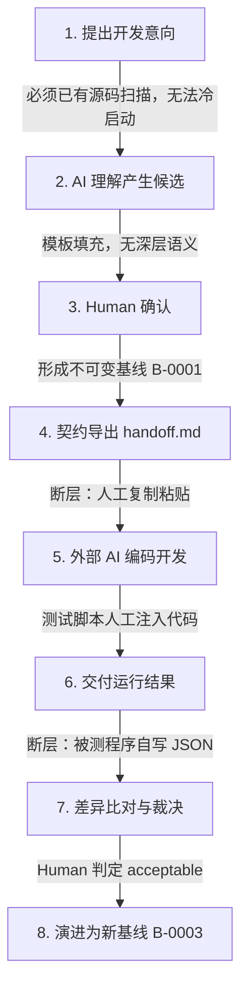

# AsWish 当前工程现状与产品成功条件客观调查报告
**文件编号**：`ASWISH-CURRENT-REALITY-AUDIT-20261008.md`  
**调查基准日期**：2026-10-08  
**调查人**：Antigravity（独立事实审查组）  
**审查原则**：事实与证据优先（ODD 原则）、现实结果归因（EHAI L8）、严禁掩耳盗铃、严格区分 `FACT / PLAN / VISION`

---

## 1. 一页结论

### 1.1 当前整体状态
AsWish 经过前期多个工单（WO-0027 至 WO-0059、WO-0070 至 WO-0080）的密集迭代，已经成功构建了一套**高度严密、强类型定义、具备密码学哈希防篡改能力的规范与差异跟踪引擎内核（Delphi Win64 Native + Headless CLI）**。其核心数据结构（4 树投影、Snapshot 快照、Decision 决策台账、Difference 差异计算器）逻辑完备，348 项单元测试 100% 通过，且在纯代码扫描、基线冻结、结构差异比对等环节展现出扎实的工程素质。

**然而，从“真实用户软件开发工具”的视角审视，AsWish 当前正处于严重的“工程自闭环但产品断裂”状态**：
1. **外部连接断裂**：AsWish 定位为“Human ↔ AI Coding Agent ↔ Implementation”之间的开放工程层，但目前它与外部 AI Coding Agent（如 Claude Code、Cursor、Windsurf）之间**没有任何自动化交互管道**，仅能单向导出一个静态 Markdown 文本；
2. **观察源头受限**：视觉与运行时差异比对（L2/L3）严重依赖目标程序自身硬编码导出 `RuntimeObservation.json`，缺乏通用的非侵入式运行时探测能力；
3. **元治理内卷消耗**：近期（WO-0093 至 WO-0106）近 14 个连续工单的开发精力，几乎 100% 被吸入到 SPW 工具链门禁自锁、日志扫描自毒、删除钩子计数攻防、81 条存量代码豁免审批人白名单等“元治理防御体系”的猫鼠博弈中，导致真正直接面向用户价值与闭环体验的开发停滞了近一个月。

### 1.2 已经真正具备的三项最重要能力
1. **确定性的工程静态结构扫描与 4 树规范投影提取（FACT · 代码已测）**：
   能够免外部依赖递归扫描 Delphi/VCL、TypeScript/React 等既有工程源码与文档，确定性构建 Function/Module/View/Data 规范树，并生成高可读性静态 HTML/WebView2 审查界面。
2. **基于密码学哈希的不可变基线冻结与决策血统追溯（FACT · 代码已测）**：
   能够将人类对 ChangeSet 或 Visual Preview 的确认动作，原子化固化为带有双哈希（ContentHash + RelationHash）的 Accepted Baseline 快照，建立清晰不可篡改的 `Human Intent → ChangeSet → Decision → Baseline` 全程追溯链。
3. **平台级差异计算与优雅降级引擎（FACT · 局部平台已测）**：
   构建了支持 L1（文件/节点结构差异）、L2（空间相对位置）、L3（样式/外观）的平台比对扩展缝（Seam）；在缺失平台观察材料时，能可靠优雅降级为纯 L1 结构差异比对，不发生程序硬崩溃。

### 1.3 当前最重要的三个缺口
1. **自动化 AI Coding 开发衔接通道缺失（硬断裂）**：
   无法自动唤起、调度外部 Coding Agent 执行开发任务，开发执行过程完全依赖人类人工复制粘贴提示词，交付结果亦依赖手工拷贝代码。
2. **真实世界的“零侵入”运行时观察与视觉提取能力缺失（硬断裂）**：
   不支持任意被测软件的无侵入 UI 探测（如 Win32 UI Automation 或 Web DOM 自动提取），使得 L2/L3 差异比对只能在专门为 Dogfood 定制的测试打桩程序中运行。
3. **绿色开箱与“从 0 到 1”项目上手引导缺失（交付断裂）**：
   最新代码未打包分发（现存公开包为一个月前的旧版）；系统完全依赖既有源码进行逆向 scan，无法在空目录中通过自然语言意向引导用户创建全新的软件项目。

### 1.4 是否具备真实用户试用条件
**结论：当前完全不具备真实外部普通用户试用的条件。**  
当前版本仅适合仓内核心开发者通过特定的 CLI 脚本在高度受控的打桩工程（如 `dogfood_0036_project`）中进行内部回归测试，普通用户尝试安装和使用将会在初始化、AI 连接、运行时比对等环节连续撞墙。

---

## 2. 工程事实表

| 调查维度 | 当前事实状态 | 证据来源 / 实际指标 | 判定 |
|---|---|---|---|
| **代码仓库** | Git 本地主仓 `D:\_Progs\02Business\AsWish`，分支 `main` | `git status` | FACT |
| **Git HEAD** | `d436912` (2026-10-08 13:28:33 +0800) | `git log -n 1` | FACT |
| **工作区状态** | 33 个文件未提交修改，源自 WO-0106 返修工作（试图修复 H4 81 条无审批人豁免） | `git diff --stat` (788 行新增/597 行删除) | FACT |
| **代码规模** | Delphi/Pascal 源码 49 文件/26,162 行；CLI 1 文件/1,571 行；测试 31 文件/14,054 行；Python 工具 13 文件/3,155 行 | Python 统计计数 | FACT |
| **编译器/环境** | Embarcadero Delphi 13.1 (version 37.0) Win64 + Python 3.12 (Windows) | `_build.bat` 执行输出 | FACT |
| **GUI 构建** | `bin\AsWish.exe` (8,501,248 字节)，编译耗时 2.70 秒，ExitCode=0，0 Error，2 Hints | `_repro\build_out.log` | FACT (已验证) |
| **CLI 构建** | `cli\bin\AsWish.CLI.exe` (7,242,752 字节)，编译耗时 2.41 秒，ExitCode=0，0 Error，2 Hints | `_repro\build_out.log` | FACT (已验证) |
| **测试套件构建**| `tests\AsWish.Tests.exe` (11,650,048 字节)，编译耗时 3.44 秒，ExitCode=0，0 Error，4 Hints | `_repro\build_tests_out.log` | FACT (已验证) |
| **测试执行结果**| DUnitX 运行：348 Found, 348 Passed, 0 Failed, 0 Errored, 0 Leaked | `_repro\test_run.log` | FACT (已验证) |
| **安装包就绪度**| Inno Setup 脚本 `installer\AsWish.iss` 存在，但 `bin\installer\` 目录为空，未生成 Setup 安装包 | 磁盘扫描与 `os.path.exists` | FACT (缺失) |
| **公开分发包** | `dist\AsWish-v0.1.0-win64.zip` (3.9MB)，生成于 2026-09-10，距今已落后 70+ 个工单 | 文件属性与哈希对比 | FACT (过期) |
| **门禁整体状态**| 12 道门禁本地执行可达成 12/12 PASS（`RUN-20261008-052703`），但证据包被多模型判定为 `degraded / not_ready` | `_repro\spw-evidence-d436912.json` | FACT (降级) |
| **现存阻塞缺陷**| 1. H4 81 条基线豁免无审批人（RZB-012, P1）；2. head_commit 逃逸口过宽（RZB-013, P2）；3. 回合计数键缺 env 降级（RZB-014, P2） | `WO\WO-20261006-0106` | FACT (未闭环) |
| **近期开发重点**| 连续 14 个工单集中在 SPW 门禁凭证钉死、防自指、双向哈希断言、删除保护钩子 | Git 提交记录与 WO 目录 | FACT |

---

## 3. 六项核心能力现状

### 能力 1：意向表达（Intent Expression）
- **当前实际能力**：
  支持用户在既有规范树的指定节点（Node ID）上输入自然语言需求，生成结构化的 `Candidate Intent` 并派生 `ChangeSet`（变更集候选）。支持通过 GUI Inspector 面板输入，或通过 CLI `AsWish.CLI intent` 命令录入。
- **对应代码入口**：
  - GUI: `TAsWishMainForm.PerformInspectorSubmit` ([AsWish.MainForm.pas](file:///d:/_Progs/02Business/AsWish/src/app/AsWish.MainForm.pas#L1192))
  - Controller: `TAsWishController.SubmitUserIntent` ([AsWish.Controller.pas](file:///d:/_Progs/02Business/AsWish/src/controllers/AsWish.Controller.pas#L1233))
  - CLI: `RunIntent` ([AsWish.CLI.dpr](file:///d:/_Progs/02Business/AsWish/cli/AsWish.CLI.dpr#L353))
- **运行/测试证据**：
  `Test.AsWish.GUIDecisions.pas` 中的 `Test_DualSurface_D1_SubmitUserIntent_WithTreeInference` 测试通过；`WO\evidence\dogfood-0036-甲.log` 第 3 步实跑通过。
- **已知缺陷与限制**：
  1. **必须绑定既有节点**：意图必须挂在已有树的 Node ID 上，无法直接表达宏观跨模块意图或提出全新的项目构想；
  2. **缺少多轮澄清（Conversation Surface 缺位）**：输入意图后，无法在界面内与 AI 进行苏格拉底式的多轮追问或需求推敲；
  3. **意向转换能力粗糙**：`TAsWishController.GenerateChangeSetFromIntent` 仅简单地将用户意图字符串写入目标节点的 `summary` 字段，缺乏深层语义推演。
- **完成状态**：**部分实现 (PARTIAL FACT)**

### 能力 2：契约形成（Contract Formation）
- **当前实际能力**：
  用户通过 0-9 键盘或界面按钮接受变更集后，系统将其原子化持久化为 `TSpecDecision`，并创建带时间戳的不可变基线快照目录（`Accepted Baseline`）。快照内固化 4 树 YAML，并计算确定性的 ContentHash 与 RelationHash。
- **对应代码入口**：
  - `TAsWishDecisionsService.AcceptChangeSet` ([AsWish.Services.Decisions.pas](file:///d:/_Progs/02Business/AsWish/src/services/AsWish.Services.Decisions.pas#L400))
  - `TAsWishSnapshotService.CreateBaseline` ([AsWish.Services.Snapshot.pas](file:///d:/_Progs/02Business/AsWish/src/services/AsWish.Services.Snapshot.pas#L250))
- **运行/测试证据**：
  `Test.AsWish.Baseline.pas` 11 项用例全部通过（涵盖哈希确定性、血统追溯、不可变防篡改）；`dogfood_first_user\.AsWish\snapshots\` 落地存储完好。
- **已知缺陷与限制**：
  契约内容主要是静态树结构属性（title, summary, kind, parent_id），行为规则（如业务逻辑用例、时序契约）只能以非结构化文字存放在说明字段中，无法直接转为机器可判定判据。
- **完成状态**：**已验证 (FACT)**

### 能力 3：AI 开发衔接（AI Development Bridging）
- **当前实际能力**：
  能够将已确认的 Accepted Baseline、视图组件列表以及（若存在的）布局意图导出为静态的 `agent-handoff.md` 说明文件。系统内建了一个简单的 OpenAI/ModelScope HTTP 调用客户端（`TAsWishLLMService`），但仅用于将初始扫描得到的 `context-pack.md` 发送给模型生成结构树 YAML。
- **对应代码入口**：
  - `TAsWishVisualWorkflowService.ExportAgentHandoff` ([AsWish.Services.VisualWorkflow.pas](file:///d:/_Progs/02Business/AsWish/src/services/AsWish.Services.VisualWorkflow.pas#L348))
  - `TAsWishLLMService.Generate` ([AsWish.Services.LLM.pas](file:///d:/_Progs/02Business/AsWish/src/services/AsWish.Services.LLM.pas#L111))
- **运行/测试证据**：
  `Test.AsWish.VisualWorkflow.Provenance.pas` 中的 `Test01_ExportAgentHandoff_ContainsLayoutIntentAndProvenance` 测试通过。
- **已知缺陷与限制**：
  1. **完全没有 Coding Agent 调度器**：AsWish 不负责也不调用任何外部编码 Agent（Claude Code / Aider 等）；
  2. **执行过程完全脱缰**：外部 Agent 拿走 `agent-handoff.md` 后，如何编码、是否遵循契约、中途修改了哪些文件，AsWish 在开发过程中完全不可见，无心跳、无进程监控。
- **完成状态**：**部分实现 (PARTIAL FACT，仅支持静态 Markdown 导出，无开发闭环衔接)**

### 能力 4：视觉一致性（Visual Consistency）
- **当前实际能力**：
  建立了从线框预览到平台差异比对的流程架构。针对 Delphi VCL 平台实现了 `TAsWishVCLDifferenceComparator` 插件，能读取外部提供的 `RuntimeObservation.json`，比对控件的相对布局关系（`left-of`, `gap`）与基础字体颜色（FontColor）。
- **对应代码入口**：
  - `TAsWishVCLDifferenceComparator.CompareL2L3` ([AsWish.Plugins.VCL.Difference.pas](file:///d:/_Progs/02Business/AsWish/src/services/AsWish.Plugins.VCL.Difference.pas#L67))
  - `TAsWishVisualWorkflowService.ComputeDifference` ([AsWish.Services.VisualWorkflow.pas](file:///d:/_Progs/02Business/AsWish/src/services/AsWish.Services.VisualWorkflow.pas#L151))
- **运行/测试证据**：
  `Test.AsWish.Difference.L2L3.pas` 5 项测试通过；Spike `WO-0030-VCL-HighFidelity` 成功输出带有 L2/L3 差异项的 `difference.yaml`。
- **已知缺陷与限制**：
  1. **无全像素视觉比对（No Pixel Diff）**：无法截取真实界面进行图像级特征比对；
  2. **严重依赖手动打桩**：`layout-constraints.json`（预期布局）和 `visual-binding.yaml`（控件与节点映射）在整个系统中**没有生成代码**，必须手工手写或注入；
  3. **被测程序需自我插桩**：被测软件必须自己遍历控件并输出 `RuntimeObservation.json`，AsWish 自身无注入式或自动化 UI 探测能力；
  4. **平台极窄**：除 VCL 外，Web、WPF、移动端等均为 0 支持（自动降级为 L1）。
- **完成状态**：**部分实现 (PARTIAL FACT，仅为受控打桩环境下的概念验证)**

### 能力 5：差异裁决（Difference Judgment）
- **当前实际能力**：
  实现了完整的差异发现、结构化持久化（`difference.yaml`）、可视呈现（`difference.html`）以及人机裁决流程。Human 可以对差异作出 `acceptable`、`unacceptable` 或 `unresolved` 裁决。若裁决为 `acceptable`，支持调用 `evolve` 将现实状态原子化演进为新的 Accepted Baseline（差异清零并保留历史指针）。
- **对应代码入口**：
  - `TAsWishDifferenceService.ComputeDifference` ([AsWish.Services.Difference.pas](file:///d:/_Progs/02Business/AsWish/src/services/AsWish.Services.Difference.pas#L120))
  - `TAsWishVisualWorkflowService.RecordDifferenceDecision` ([AsWish.Services.VisualWorkflow.pas](file:///d:/_Progs/02Business/AsWish/src/services/AsWish.Services.VisualWorkflow.pas#L234))
  - `TAsWishVisualWorkflowService.EvolveBaseline` ([AsWish.Services.VisualWorkflow.pas](file:///d:/_Progs/02Business/AsWish/src/services/AsWish.Services.VisualWorkflow.pas#L274))
- **运行/测试证据**：
  `Test.AsWish.RevisionEvolution.pas` 7 项测试全部通过；`WO\evidence\dogfood-0036-甲.log` 实跑通过从 B-0001 裁决并 evolve 至 B-0003。
- **已知缺陷与限制**：
  当判定为 `unacceptable`（Revision 分支）时，系统仅记录决策拒绝状态，无法自动驱动被测工程回滚代码或向 Coding Agent 下发返工工单。
- **完成状态**：**已验证 (FACT)**

### 能力 6：经验承接（Experience Continuity）
- **当前实际能力**：
  系统仅能在单个项目内部记录决策历史（`requirement-decisions.yaml` 和 `decisions.html`）。
- **对应代码入口**：
  `TAsWishDecisionsService.Save` / `TAsWishRenderService.RenderDecisionsHtml`
- **运行/测试证据**：
  仅验证了单工程内的 decisions 读写与 HTML 渲染。
- **已知缺陷与限制**：
  跨项目的“差异案例库（Difference Case）”、“经验回流与推荐”以及“差异社区”在当前代码库中**零实现**，仅存在于设计哲学与愿景文档中。
- **完成状态**：**愿景阶段 (VISION · 当前零实现)**

---

## 4. 真实端到端流程调查

以仓内最具代表性的深层 Dogfood 案例——`dogfood\dogfood_0036_project`（订单结算系统，包含 7 个文件、4 个目录）为例，对端到端软件开发完整链条进行穿透审计：

### 逐步骤执行审计

1. **用户提出开发意向**：
   - *实现情况*：实现。
   - *人工绕过*：必须先有一个预先存在的工程并执行 `scan` 产生 `func-payment-retry` 节点后，才能输入意向。无法在空目录下提出初始意向。
   - *入口*：GUI Inspector 或 CLI `AsWish.CLI intent`。
   - *输入/输出*：输入节点 ID 与自然语言；输出 `candidate-intent.yaml`。
2. **AI 理解并产生候选**：
   - *实现情况*：部分实现。
   - *人工绕过*：未调用实际 LLM 进行智能拆解，直接由模板逻辑派生为单一 ChangeSet `cs-func-payment-retry-01`。
3. **Human 确认与契约形成**：
   - *实现情况*：完整实现。
   - *操作*：CLI 执行 `changeset accept` 或 GUI 点击 Commit。
   - *输出*：生成 Accepted Baseline `B-0001`，冻结快照，产生不可变哈希。
4. **AI 执行开发**：
   - *实现情况*：**未实现（存在绝对断裂）**。
   - *真实情况*：AsWish 执行 `handoff` 导出一个 `agent-handoff.md`。但之后没有调用任何 Agent。在 Dogfood 记录中，是由测试脚本直接通过文件 IO 修改了 `Billing.pas` 并新建了 `Notification.pas`，模拟“代码漂移”。**真实开发中需要开发者手动将 handoff 交给 AI，再手动将 AI 代码拷回。**
5. **交付运行结果**：
   - *实现情况*：**部分实现（存在严重假定）**。
   - *真实情况*：如果是纯代码，AsWish 运行 `evidence collect` 读取源码文件并计算哈希；但若涉及视觉 UI 比对，被测程序必须自己实现一套枚举窗体控件并写入 `RuntimeObservation.json` 的代码。普通开发不可能满足此要求。
6. **比较预期与实际差异**：
   - *实现情况*：实现。
   - *真实情况*：在 Dogfood 0036 案例中，由于 B-0001 是 `function` 树基线，而修改的是 `Billing.pas`（模块代码），差异引擎对比 function 树后输出 **“No structural differences found (0 items)”**。比对结果差异项为 0。
7. **Human 裁决与演进**：
   - *实现情况*：实现。
   - *操作*：用户执行 `judge B-0001 acceptable`，并执行 `evolve B-0001`。
   - *输出*：系统根据现实状态演化出新基线 `B-0003`，并在 decisions 中留痕。

### 端到端闭环明确结论
**当前 AsWish 无法在“不修改代码、不依赖开发者临时干预”的条件下，完成一次真实的端到端软件开发闭环。**  
历史测试记录中的“SUCCESS”，是依托预设工程、人工模拟代码变更、预置硬编码打桩观察文件的产物，真正的端到端用户流在“开发委托”与“真实观察提取”两个核心接口处存在硬性断点。

---

## 5. 人机交互现状与可靠性

### 5.1 人机交互现状（EHAI / HB 交互承接）
1. **Candidate-first（候选优先）原则**：
   - *落实情况*：部分落实。在规范节点变更时，强制走 `Candidate Ingest → ChangeSet → Review → Accept/Reject` 流程，禁止直接暗中修改主规范树。
   - *缺陷*：生成的候选往往只有单一项，缺乏 2~3 个不同技术路径或不同视觉方案的真实候选集供用户挑选。
2. **0–9 统一选择协议**：
   - *落实情况*：原生窗体键盘绑定已经实现。`KeyPreview := True`，支持 `1..7` 切换候选，`8` 重新生成，`9` 自由输入/覆盖，`0` 返回上一级，`Enter` 确认，`Esc` 拒绝。
   - *体验缺陷*：主界面大量内容依托在 WebView2 网页内展示，当焦点落在 WebView2 内部时，原生窗体的 `FormKeyDown` 无法截获键盘消息，导致 0-9 快捷键频繁失灵，交互割裂感明显。
3. **五档请示偏好（Five-level Preferences）**：
   - *落实情况*：**未在 GUI 中生效**。相关偏好定义停留在理论和配置枚举中，GUI 并没有根据人类偏好自动收缩或展开请示弹窗。
4. **最影响当前体验的三个交互问题**：
   - **问题一：WebView2 与 Delphi 原生控件的焦点争夺与快捷键失效**（WebView2 获得焦点后，0-9 键盘协议完全瘫痪）；
   - **问题二：必须从树节点出发的逆向操作路径**（用户无法直接说“我想做个计算器”，必须先找到 `view-form` 或 `func-root` 点击 Inspector 才能输入）；
   - **问题三：概念术语过于深奥晦涩**（界面到处是 Dual-Surface、HB Deck、Fog State、L1-L3 Drift 等理论黑话，普通开发者无法凭直觉理解）。

### 5.2 产品交付与可靠性
1. **多次执行相同任务的可靠性**：
   - 哈希计算、规范树解析和静态 HTML 渲染具备极高的确定性，多次执行相同扫描能得到完全一致的结果。
2. **异常中断恢复与数据安全性**：
   - 快照目录采用独立只读命名，数据丢失风险低。
   - 最新未提交改动引入了 `AtomicWriteTextFile`（临时文件写入后重命名替换），修复了直接写入时断电或冲突损坏文件的风险。
3. **更换模型与外部模型故障处理**：
   - 依赖标准 OpenAI 协议，可通过配置切换端点；
   - 当 API Key 为空或网络异常时，系统能在日志中给出友好错误提示并退回手动复制 Prompt 模式，不会导致桌面端闪退。
4. **新用户安装与初次使用门槛**：
   - **极高**。没有可点击安装的 Release 安装包；必须具备 Delphi / Python / WebView2 运行环境并手动执行批处理命令；缺少新手引导项目与 Hello World 模板。

---

## 6. 产品成功标准的可验证性

评估 AsWish 衡量以下 5 个关键产品成功指标的真实准备情况：

| 指标项 | 现有数据状况 | 能否从系统提取 | 缺失的关键证据 | 能否与不使用 AsWish 进行对照 |
|---|---|---|---|---|
| **1. 意向实现率** | **无数据** | 否（系统仅记录 ChangeSet 是否被 Accept，不理解最终软件是否符合心意） | 缺乏人类用户对最终软件满意度的主观评分或验收测试用例通过率数据 | 暂不可比 |
| **2. 人类操作时间与介入次数** | **部分数据** | 可提取部分（Decisions 包含时间戳，HB 记录操作源） | 缺少端到端任务计时日志（开发、等待、调试各阶段耗时未拆分） | 可通过 A/B 实验测量（但当前未做） |
| **3. 返工次数与返工时间** | **极少数据** | 理论上可提取（可统计 Revision 决策数与历史基线链长度） | 真实项目中目前几乎没有长链路返工数据，大多在第 1~2 个回合即强制 evolve | 缺乏多轮修改的真实样本 |
| **4. 关键决策与结果可追溯性** | **高度完备 (FACT)** | **是（完全可提取）** | 追溯链条（Intent → ChangeSet → Decision → Baseline → Evidence）在数据层完全闭环且经过哈希断言 | **完全超越传统方式**，传统方式完全无此结构化血统 |
| **5. 真实用户是否愿意再次使用** | **绝对零数据** | 否 | **无外部真实用户测试**。目前所有运行日志均来自 AI 开发者或内部测试脚本 | 无法评估 |

> **严肃结论**：AsWish 在“决策与契约可追溯性（指标 4）”上已经具备坚实的工程测量条件，但在其余所有涉及真实用户心理、生产力提升与端到端交付的指标上，**目前均缺乏有效数据支撑，严禁对外宣称产品已获得用户验证。**

---

## 7. 对现有开发工作的评价

依据“是否直接推动真实用户完成开发闭环”，对当前正在执行与近期执行的工作进行客观分类：

### A 类：直接支持真实用户完成开发闭环
- **WO-0036 (Master Consolidation Dogfood)**：打通了真实多目录工程的 12 步基线与演化全流程；
- **WO-0052 / WO-0053 (Scan & CLI 收敛)**：统一了 CLI 与 GUI 的工程类型识别与扫描结果真相源。

### B 类：闭环必要的可靠性、质量与交付保障
- **H2 单元测试套件维护 (348 项用例保持 100% 通过)**；
- **`AtomicWriteTextFile` 文件原子写入机制**（刚由本地修改引入，防止文件写入竞争损坏）；
- **H3 编码守卫 (`gate_encoding_guard.py`)**：确保跨平台源码与日志的 UTF-8 编码整洁。

### C 类：长期架构和未来扩展（目前非阻塞，建议延后）
- **Difference Commons 系列 (`WO-0041` 至 `WO-0048`)**：在单机桌面闭环尚未通畅的前提下，过早投入公共差异中心化与跨项目协议沉淀；
- **差异社区与公众价值层理念 (`docs/AsWish-公众价值层与差异社区理念-v1.md`)**：属于未来生态愿景，在用户量为零的阶段投入开发无实际产出。

### D 类：疑似偏离当前产品目标，陷入严重治理内卷（建议立即止血）
- **近期工具链门禁审查自毒治理 (`WO-0093` 至 `WO-0106`)**：
  - *典型症状*：
    - 门禁日志因打印“主控”关键字导致自己被外部边界扫描拦截，从而引入排除规则（RZB-001）；
    - 排除规则导致发布包漏掉说明文档或误包含标记（RZB-006, RZB-011）；
    - 安全删除钩子按回合计数导致单文件测试清理被拦截，进而引发钩子改键与环境依赖静默失效（RZB-005, RZB-010, RZB-014）；
    - 81 条存量代码中的直接文件写（`TFile.WriteAllText`）被 H4 门禁拦截，为消除红灯引入无审批人豁免，进而被异构模型 observer 判为 BLOCKER，再引发新工单（RZB-012, WO-0106）。
  - *评价*：**这是极其典型的“为了满足机器门禁而修改测试脚手架、为了掩盖测试脚手架改动而修改门禁规则”的自指死锁循环**。它消耗了团队近半个月的核心带宽，却未给真实用户增加一行可用功能。

---

## 8. 下一阶段建议

基于上述事实，强烈建议 Human Authority 叫停治理工具链的自锁内卷，将全部研发资源集中在以下三个最短路径方向：

### 方向一：封装真实 Coding Agent 的无缝调用管道（完成核心能力 3）
- **核心收益**：打通用户最痛的“AI 开发执行断层”。用户在 AsWish 中确认基线后，能一键唤起本地已安装的 Agent（如 `claude` CLI 或 `aider`），自动将 `agent-handoff.md` 作为初始约束输入，并在 Agent 执行完毕后自动触发 `evidence collect`。
- **前置依赖**：稳定导出的 `agent-handoff.md`（已有）。
- **主要风险**：不同 Agent CLI 的参数和交互协议存在差异，需先以一种主流工具（如 Claude Code）为参照实现适配器。

### 方向二：实现通用无侵入式 UI 探测适配器（完成核心能力 4）
- **核心收益**：解除被测程序必须自己实现 `RuntimeObservation.json` 的荒谬限制。针对 Windows 桌面应用，利用系统自带的 Windows UI Automation (UIA) 编写一个独立的 50 行通用探测脚本，自动按窗体句柄抓取控件树、坐标与类名；针对 Web 应用，利用 Playwright 自动抓取 DOM 树。
- **前置依赖**：无。
- **主要风险**：OwnerDraw、非标准渲染（如 DirectUI/Flutter）控件难以获取真实语义，但在标准 Win32/VCL/Web 体系下完全可行。

### 方向三：构建一键安装分发与“从零新建（0 到 1）”项目向导（打通交付端）
- **核心收益**：让真实外部用户能够下载一个 `.exe` 顺利装上并跑通第一个案例。提供一个初始的“新建空白工程向导”，允许用户输入一段自然语言愿景，系统自动生成初始目录骨架与初始 4 树，然后再进入 AsWish 的确认与开发循环。
- **前置依赖**：现有的 Inno Setup 脚本（`installer\AsWish.iss`）。
- **主要风险**：WebView2 运行时在个别精简版 Windows 上的缺失，可通过 Evergreen Bootstrapper 自动引导下载解决。

---

## 9. 证据索引

1. **Git 提交与变更证据**：
   - 现行 HEAD 提交：`d4369124e9a420b2eb00e4b3b198678b51f05ce7` (WO-0105 修复)
   - 假绿灯与 G 门死锁问题复验：`WO\WO-20261006-0105-主控-WO-0104交付复验台账记假绿灯G门实跑FAIL却记PASS钩子计数改键后按回合防批量删除整体失效.md`
   - 81 条无审批人豁免与逃逸口遗留工单：`WO\WO-20261006-0106-主控-WO-0105复验遗留项H4基线豁免零审批仍全绿81条无审批人head_commit逃逸口能换掉被钉范围回合计数键缺环境变量静默退回病灶形态.md`
2. **源码实现入口**：
   - GUI 主界面与交互事件分发：[`src/app/AsWish.MainForm.pas`](file:///d:/_Progs/02Business/AsWish/src/app/AsWish.MainForm.pas)
   - 核心业务编排控制器：[`src/controllers/AsWish.Controller.pas`](file:///d:/_Progs/02Business/AsWish/src/controllers/AsWish.Controller.pas)
   - 视觉工作流与 Agent Handoff 导出：[`src/services/AsWish.Services.VisualWorkflow.pas`](file:///d:/_Progs/02Business/AsWish/src/services/AsWish.Services.VisualWorkflow.pas)
   - VCL 平台 L2/L3 差异比对插件：[`src/services/AsWish.Plugins.VCL.Difference.pas`](file:///d:/_Progs/02Business/AsWish/src/services/AsWish.Plugins.VCL.Difference.pas)
   - 证据收集器实现：[`src/services/AsWish.Services.EvidenceCollector.pas`](file:///d:/_Progs/02Business/AsWish/src/services/AsWish.Services.EvidenceCollector.pas)
   - 命令行统一分发入口：[`cli/AsWish.CLI.dpr`](file:///d:/_Progs/02Business/AsWish/cli/AsWish.CLI.dpr)
3. **真实运行与测试日志**：
   - 348 项全量单元测试通过日志：[`_repro/test_run.log`](file:///d:/_Progs/02Business/AsWish/_repro/test_run.log)
   - GUI 与 CLI 编译器构建日志：[`_repro/build_out.log`](file:///d:/_Progs/02Business/AsWish/_repro/build_out.log)
   - 12 步 Dogfood 端到端执行日志：[`WO/evidence/dogfood-0036-甲.log`](file:///d:/_Progs/02Business/AsWish/WO/evidence/dogfood-0036-甲.log)
   - 包含异构 observer 判定 blocker 的综合证据包：[`_repro/spw-evidence-d436912.json`](file:///d:/_Progs/02Business/AsWish/_repro/spw-evidence-d436912.json)
4. **历史发布包事实**：
   - 现存二进制分发包：[`dist/AsWish-v0.1.0-win64.zip`](file:///d:/_Progs/02Business/AsWish/dist/AsWish-v0.1.0-win64.zip)（生成时间 2026-09-10 10:01:43）
