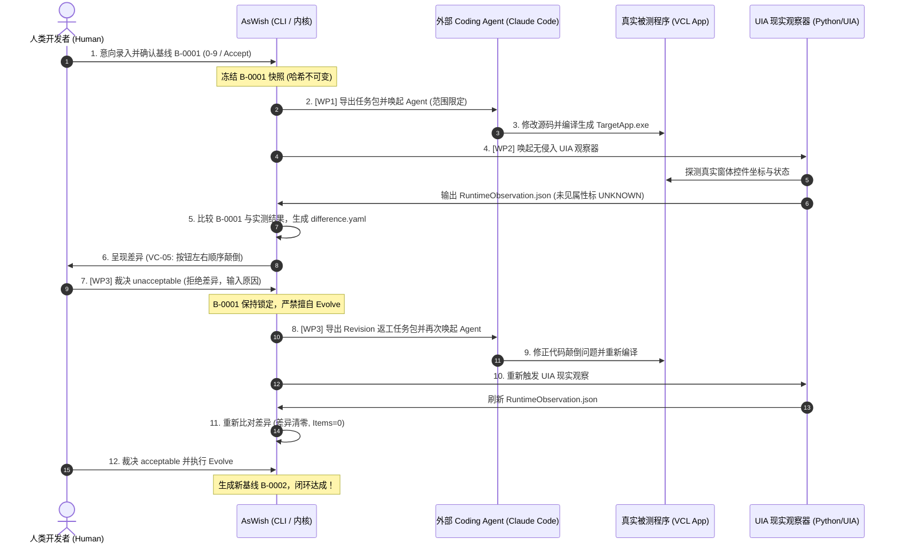

# AsWish 产品闭环优先级收敛与最小开发方案
**文件编号**：`ASWISH-MINIMUM-REAL-WORLD-LOOP-20261008.md`  
**基准日期**：2026-10-08  
**方案状态**：提案草案（待 Human Authority 审阅裁决，不擅自修改既有冻结协议）  
**依据来源**：`ASWISH-CURRENT-REALITY-AUDIT-20261008.md` 现实审查结论

---

## 〇、工作性产品定位与设计原则

### 1. 工作性产品定位（定位确认）
> **AsWish 是以人类意向为中心，连接 AI 执行与现实产物的开放控制系统。**

核心职责聚焦于五件事：
1. **意向显影与确认**：让人类模糊的想法能够通过结构化投影与视觉线框显影，并形成确定性意向；
2. **契约、决策与基线的保存与追溯**：将确认的心意转化为带密码学防篡改凭证的不可变基线；
3. **与外部 Coding Agent 交换任务与交付结果**：不自研 Agent 引擎，只做边界明确的任务输出与交付物接收；
4. **现实结果的观察、验证与差异呈现**：非侵入式获取现实软件运行状态，让现实与预期的变化清晰可见；
5. **人类裁决与后续演进/修正**：由人决定接受差异（演进基线）或拒绝差异（触发返工修正）。

**反向清单（明确不做）**：
- 不自研通用 AI 编程模型或代码补全插件；
- 不建设复杂的通用 Agent 工作流编排引擎；
- 不自建跨平台通用图像渲染与像素对比引擎；
- 不开展脱离单机闭环的中心化“差异社区”与跨项目经验共享库。

---

## 一、当前已有能力及可复用代码资产

在启动任何新开发前，经对代码库的全面审计，AsWish 已经具备相当厚实的底层内核资产，**90% 的核心基础设施可以直接复用**：

| 能力模块 | 所在代码单元 | 当前实现状态 | 可复用程度与复用方式 |
|---|---|---|---|
| **4 树规范存储与原子 IO** | `AsWish.Services.SpecStore.pas`<br>`AsWish.Yaml.Parser/Writer.pas` | FACT (已测) | **100% 复用**。完全支持 Function, Module, View, Data 4 树的读写，已具备 `AtomicWriteTextFile` 防损坏机制。 |
| **决策台账与状态机** | `AsWish.Services.Decisions.pas` | FACT (已测) | **100% 复用**。`TSpecDecision` 支持 `dtConfirm`, `dtReject`, `dtAcceptDifference`；状态机严格防护未决/拒绝决策。 |
| **快照与不可变基线** | `AsWish.Services.Snapshot.pas` | FACT (已测) | **100% 复用**。完全具备带有 ContentHash 与 RelationHash (SHA-256) 的不可变快照创建、验证与回放能力。 |
| **物理实现证据收集** | `AsWish.Services.EvidenceCollector.pas` | FACT (已测) | **100% 复用**。支持根据基线 `source_refs` 扫描源码文件、提取代码片段与计算 SHA-256 摘要，已具备优雅降级能力。 |
| **差异比对扩展缝 (Seam)** | `AsWish.Services.Difference.pas` | FACT (已测) | **100% 复用**。已实现通用的 L1 结构差异比对，并开放了 `IPlatformDifferenceComparator` 平台扩展接口。 |
| **VCL 差异比对插件** | `AsWish.Plugins.VCL.Difference.pas` | FACT (部分已测) | **95% 复用**。已实现 L2 空间布局比对（`left-of`, `gap`）和 L3 颜色比对逻辑，仅需补充 UNKNOWN 属性容错。 |
| **视觉工作流门面** | `AsWish.Services.VisualWorkflow.pas` | FACT (已测) | **95% 复用**。已编排好基线确认、差异计算、决策记录、基线演进（Evolve）以及初步的 `ExportAgentHandoff`。 |
| **CLI 统一调度器** | `cli/AsWish.CLI.dpr` | FACT (已测) | **100% 复用**。已拥有 17 项命令行子命令结构，直接在此处挂载 Agent 适配器与观察器子命令即可。 |

---

## 二、WP1～WP3 最小实现方案

为了达成“人类意向 → 契约 → Agent 执行 → 现实观察 → 人类裁决 → 修正闭环”的真实闭环，只需在既有代码之上做**精准、最小化手术刀式的增量补齐**。



---

### WP1：外部 Agent 双向交付适配器（最小方案）

#### 1. 现有 `agent-handoff.md` 的可用性复核与补充
- **现状**：现有 `agent-handoff.md` 包含 Baseline Target、View Components、Declared Relative Layout Intent & Provenance。这些内容作为给 LLM 的逻辑约束非常清晰。
- **缺口**：缺少工程上下文元数据，Agent 不知道该改哪个文件、在哪编译。
- **最小补充**：在 `TAsWishVisualWorkflowService.ExportAgentHandoff` 中增加一段机器可读的 `Execution Boundaries` 区块：
  ```markdown
  ## 5. Execution Scope & Boundaries
  - Target Project Root: <ProjectDir>
  - Allowed Modified Files: ["src/MainForm.pas", "src/MainForm.dfm"]
  - Strictly Forbidden Paths: [".AsWish/**"]
  - Build & Verify Command: "dcc64 -B MainForm.pas" (or TargetApp.dpr)
  ```

#### 2. CLI 最小适配器调用方式
- 不造通用 Agent 调度中心。针对当前系统已安装的 `claude` CLI（`C:\Users\Administrator\.local\bin\claude.EXE`），编写轻量适配器。
- 在 `AsWish.CLI` 中新增命令：
  ```bash
  AsWish.CLI agent execute <project-dir> [baseline-id] [--adapter claude]
  ```
- **执行逻辑**：
  1. 读取目标项目下的 `.AsWish/handoff/agent-handoff.md`；
  2. 生成适配任务提示：将 handoff 内容作为 prompt；
  3. 通过标准 Windows API（`CreateProcessW`）在 `<project-dir>` 目录下非交互式调用：
     `claude -p "<PromptText>" --dangerously-skip-permissions`
  4. 等待进程结束，记录超时（默认 180s），捕获退出码及输出。

#### 3. 严格的安全与边界控制
- **工作目录锚定**：必须且仅能在 `<project-dir>` 内执行，严禁工作区越界；
- **只读区域防护**：在调用外部 Agent 前后，利用 Git 状态（`git status --porcelain`）或内存哈希快照进行比对。如果发现 Agent 修改了 `.AsWish/snapshots/`、`.AsWish/decisions/` 或项目外部文件，执行器立刻报错并标记该交付为**越权非法交付（Unauthorized Breach）**，阻断后续流转。

#### 4. 证据收集与元数据追溯
- 执行产物全部留痕在 `.AsWish/agent-runs/<run-id>/`：
  - `agent.log`：完整的标准输出与标准错误；
  - `agent-execution.yaml`：
    ```yaml
    run_id: "run-20261008-180102"
    baseline_id: "B-0001"
    decision_id: "dec-0001"
    adapter: "claude-cli"
    exit_code: 0
    duration_ms: 18450
    modified_files:
      - "src/MainForm.dfm"
      - "src/MainForm.pas"
    status: "completed"
    ```
- 执行完毕后，CLI 自动调用现有的 `TAsWishEvidenceCollectorService.CollectImplementationEvidence`，将实际源码变动更新到 `implementation-evidence.yaml` 中，完成血统绑定。

---

### WP2：VCL 现实观察（非侵入式 UIA 方案）

#### 1. 现有 VCL Difference 插件输入契约复核
- 现有 `TAsWishVCLDifferenceComparator` 依赖：
  1. `ObservationJson`：包含 `Observations` 列表（`Name`, `ClassName`, `Bounds`, `FontColor`）；
  2. `ConstraintsJson`：相对位置约束（`left-of`, `gap`）；
  3. `IdentityResolver`：平台控件名到规范节点 ID 的映射。

#### 2. 非侵入式 Windows UI Automation 采集机制
- **摒弃让被测软件自写 JSON 的侵入式做法**。利用 Windows 原生 UI Automation (UIA) 机制，提供一个极简的独立 Python 观察器工具：`tools/vcl-observe/observe_vcl.py`。
- **调用方式**：
  ```bash
  python tools/vcl-observe/observe_vcl.py --exe <PathToTargetApp.exe> --output <ProjectDir>/.AsWish/evidence/runtime-observation.json --timeout 5
  ```
- **核心采集原理**（利用 Python `ctypes` 调用 Windows `UIAutomationCore.dll` 或 Win32 `EnumChildWindows`）：
  - 启动目标程序（或附加到已运行窗体句柄）；
  - 枚举顶层窗口及其所有子控件；
  - 读取每个控件的：
    - `ClassName`（通过 Win32 `GetClassNameW` 或 UIA `ClassNamePropertyId`，获取 `TButton`, `TEdit`, `TPanel` 等）；
    - `Name / Caption`（通过 `WM_GETTEXT` 或 UIA `NamePropertyId`）；
    - `Bounds`（通过 `GetWindowRect` 或 UIA `BoundingRectangle`，获取 `Left`, `Top`, `Width`, `Height`）；
  - 计算各控件相对于主窗体客户区的相对坐标；
  - 退出目标进程，输出符合契约的 `runtime-observation.json`。

#### 3. 控件到规范节点的自动映射（消除手动编写 `visual-binding.yaml`）
- 依据 `TAsWishTreeBuilder` 从 DFM 建立 View 树的既有规则：
  规范节点 ID 严格为 `'view-ctrl-' + LowerCase(DfmControlName)`。
- **自动解析机制**：
  在 `AsWish.Services.Difference.pas` 中增强 `IPlatformIdentityResolver` 的默认行为：
  若未显式提供 `visual-binding.yaml`，系统按内置规则自动推导：
  `TryResolveNodeId(ControlName) := 'view-ctrl-' + LowerCase(ControlName)`。
  这一改动将彻底免除手工维护 mapping 文件的繁琐，达到开箱即用。

#### 4. 无法观察属性的 UNKNOWN 显式处理（防伪造一致）
- UIA 无法非侵入式探测私有 VCL 样式（如 `FontColor`、自定义画布 OwnerDraw）。
- **规则明确**：
  在输出的 `runtime-observation.json` 中，无法探测的属性统一输出为 `null`：
  ```json
  {
    "Name": "BtnCancel",
    "ClassName": "TButton",
    "Bounds": {"Left": 276, "Top": 160, "Width": 80, "Height": 30},
    "FontColor": null
  }
  ```
- 在 `TAsWishVCLDifferenceComparator` 中增加防守逻辑：
  当观测属性为 `null` 时，**严禁将其视为 0 (clBlack) 产生假差异，也严禁静默认定为匹配**；
  将其在差异报告中标记为 `observability: unknown` / `aspect: unobservable`，不干扰 L2 布局裁决。

---

### WP3：拒绝差异后的修正闭环（最小方案）

#### 1. 现有 `unacceptable` 裁决记录的信息复核
- 经代码审查，当前执行 `judge unacceptable <rationale>` 时，`TAsWishDecisionsService` 已经完备记录了：
  - `LDec.DecisionType := dtReject;`
  - `LDec.Status := dsRejected;`
  - `LDec.Rationale := ARationale;`（人类输入的拒绝理由，如“Cancel 按钮应在 Confirm 左侧，请勿颠倒”）；
  - `LDec.TargetNodes := [...]`（发生差异的具体节点列表）；
  - `difference.yaml` 中完整留存了差异明细（如实测 `Confirm Left=180, Cancel Left=276`）。

#### 2. 修正任务包（Revision Task Package）生成
- 新增 CLI 命令：
  ```bash
  AsWish.CLI revision export <project-dir> <baseline-id> <decision-id>
  ```
- 在 `.AsWish/handoff/` 下自动组装 `revision-handoff-<decision-id>.md`：
  ```markdown
  # Agent Revision & Correction Package
  > **PURPOSE**: Rectify unacceptable differences discovered in implementation.

  ## 1. Target Baseline
  - Baseline ID: B-0001
  - Rejected Decision: dec-0002

  ## 2. Unacceptable Differences Observed
  - Constraint Violated: `node_btn_cancel` left-of `node_btn_confirm`
  - Observed Reality: Confirm (Left=180) left-of Cancel (Left=276)

  ## 3. Human Correction Directive
  "Cancel button must be placed on the left side of Confirm button. Fix the layout coordinates in MainForm.dfm."

  ## 4. Required Action
  Modify the source code to strictly resolve the observed differences and fulfill the human directive.
  ```

#### 3. 再交付、再观察与差异收敛验证
- 外部 Agent 读取 `revision-handoff.md`，执行修复代码；
- 重新触发 `observe_vcl.py` 获取新的真实观测数据；
- 重新调用 `evidence collect` 与 `difference`；
- **差异收敛判断**：
  若新报告中 `Items` 清零（0 differences），则向人类呈现“差异已消除（Confidence 恢复）”；
- **基线防线复用**：
  在人类重新执行 `judge acceptable` 之前，`EvolveBaseline` 原生代码（`LDec.Status <> dsAccepted` 抛异常）**100% 拒绝演进基线**。只有当人类认可本次修正并签署新的接受决策时，系统才允许演进生成新一代基线 `B-0002`。

---

## 三、依赖顺序、风险及需要的接口定义

### 1. 依赖执行顺序
```text
Phase 1: WP2 (现实观察工具) ──► 必须先有非侵入真实眼球，否则 Agent 交付无法验证
   │
   ▼
Phase 2: WP1 (Agent 执行管道) ──► 有了眼球，才能让 Agent 干活并回收证据
   │
   ▼
Phase 3: WP3 (返工修正闭环)   ──► 初次开发出现偏差时，启动返工复验循环
```

### 2. 接口变动清单（极简，严格控制在现有体系内）

#### (1) `AsWish.Plugins.VCL.Difference.pas` 接口增强
```pascal
// 增加对可观察性状态的识别
type
  TObservabilityStatus = (osObserved, osUnobservable, osUnknown);

// 在 CompareL2L3 中增加对 null/缺省属性的处理：
if LItemObj.Values['FontColor'] is TJSONNull then
  // 记录为 unobservable 属性，不误发差异也不虚假报绿
```

#### (2) `AsWish.Services.Difference.pas` 映射兜底
```pascal
// 当 AContext.IdentityResolver 为 nil 时，自动使用默认规则推断：
function ResolveDefaultNodeId(const APlatformId: string): string;
begin
  Result := 'view-ctrl-' + LowerCase(APlatformId);
end;
```

#### (3) `cli/AsWish.CLI.dpr` 子命令扩展
```pascal
// 仅增加两条极简编排子命令
else if LCommand = 'agent' then
  // AsWish.CLI agent execute <project-dir> [baseline-id] [--adapter claude]
else if LCommand = 'revision' then
  // AsWish.CLI revision export <project-dir> <baseline-id> <decision-id>
```

### 3. 主要风险与对策
| 风险项 | 影响分析 | 缓解与防御措施 |
|---|---|---|
| **R1. UIA 探测进程卡死或未启动** | 目标程序挂起导致探测超时阻塞 | `observe_vcl.py` 内建强制超时机制（5秒）及自动 `taskkill` 进程守护，超时立刻抛出明确错误。 |
| **R2. Agent 误改项目协议文件** | `.AsWish` 内部数据被 Agent 篡改破坏 | 执行前后进行 Git 状态白名单审计，凡涉及 `.AsWish` 内部文件变动一律报错判废。 |
| **R3. 非窗体控件（TGraphicControl）不可见** | TLabel 等控件无独立 HWND 导致抓取不到 | 明确将纯图形控件标记为 `aspect: unobservable`，优先确保带 HWND 的交互控件（Button, Edit, Panel）L2 布局比对 100% 准确。 |

---

## 四、必须开发与可以暂缓的事项清单

为了确保在最短时间内打通真实闭环，开发范围必须受到极其严苛的约束：

### ✅ 必须开发事项（P0 · 最小闭环骨架）
1. **`tools/vcl-observe/observe_vcl.py`**：基于 Win32/UIA 的轻量非侵入控件采集脚本（约 120 行 Python，零第三方重依赖）；
2. **`AsWish.Plugins.VCL.Difference.pas` 的默认映射与 UNKNOWN 容错**：控件名自动推导为 Node ID，属性为 null 时不报假错误（约 30 行 Pascal 改动）；
3. **`AsWish.Services.VisualWorkflow.pas` 边界增强与 Revision 包导出**：在 handoff 中注明文件修改边界，增加 `ExportRevisionHandoff` 方法（约 80 行 Pascal 改动）；
4. **`cli/AsWish.CLI.dpr` 新增 `agent` 与 `revision` 入口**：桥接外部 CLI 调用与返工流程（约 90 行 Pascal 改动）；
5. **真实 VCL 示范项目（`dogfood/dogfood_vcl_loop`）**：用于验收三工单端到端跑通的真实 Delphi 工程。

### ❌ 严禁在本轮开展的事项（明确叫停/暂缓）
1. **跨平台视觉比较**：Web、React、FMX、WPF、移动端视觉比对一律不碰，保持降级为 L1 结构比对；
2. **像素级图像 Diff (Pixel Diff)**：不引入 OpenCV、Skia 等重型图像比对库；
3. **复杂多轮对话引擎 (Conversation Surface)**：不在此阶段自研苏格拉底追问界面；
4. **差异社区与跨项目经验共享**：零行代码投入；
5. **SPW 门禁工具链继续扩展**：不再增加新的门禁脚本，不对 81 条存量豁免做官僚式审批防伪补丁，保持现行静态验证即可。

---

## 五、三个工单草案与验收条件

### 工单 1：WO-20261008-LOOP-01 · 外部 Agent 最小交付适配器与边界守卫
- **角色**：开发方  
- **优先级**：P0  
- **目标**：实现 AsWish CLI 与外部 Coding Agent（Claude CLI）的双向任务传递、范围约束与证据自动刷新。
- **改动范围**：
  - `src/services/AsWish.Services.VisualWorkflow.pas`
  - `cli/AsWish.CLI.dpr`
- **验收条件 (Acceptance Criteria)**：
  - **AC1**：调用 `AsWish.CLI handoff <dir> <baseline-id>` 导出的 `agent-handoff.md`，显式包含 `Allowed Modified Files` 与 `Strictly Forbidden Paths`。
  - **AC2**：调用 `AsWish.CLI agent execute <dir> B-0001 --adapter claude` 能成功启动外部 Agent 并完成执行，退出码为 0 时记录完整的 `agent.log`。
  - **AC3**：若外部 Agent 试图修改 `.AsWish/` 内部文件，执行器能立即截获并报错退出，不更新证据。
  - **AC4**：Agent 执行完成后，自动刷新生成 `.AsWish/agent-runs/<run-id>/agent-execution.yaml`，并自动调用 evidence collector 刷新 `implementation-evidence.yaml`。
  - **AC5**：单元测试在 `tests/Test.AsWish.VisualWorkflow.pas` 中新增适配器调用模拟与边界越界拦截测试，全绿通过。

---

### 工单 2：WO-20261008-LOOP-02 · VCL 非侵入式现实观察器与属性容错
- **角色**：开发方  
- **优先级**：P0  
- **目标**：交付独立的 Win32/UIA 控件探测器，解除被测程序自我插桩要求，支持属性 UNKNOWN 显式容错。
- **改动范围**：
  - `tools/vcl-observe/observe_vcl.py`（新增工具）
  - `src/services/AsWish.Plugins.VCL.Difference.pas`
  - `src/services/AsWish.Services.Difference.pas`
- **验收条件 (Acceptance Criteria)**：
  - **AC1**：给定一个未注入任何 AsWish 代码的真实标准编译 VCL 可执行文件 `App.exe`，运行 `python observe_vcl.py --exe App.exe --output observation.json` 能够在 3 秒内抓取该窗体下所有 TButton/TEdit 的相对客户区 Bounds 坐标。
  - **AC2**：在未提供 `visual-binding.yaml` 时，差异比较器自动将控件名映射为 `'view-ctrl-' + LowerCase(Name)`，无需人工配置。
  - **AC3**：对于未采集到的样式属性（如 `FontColor: null`），比较器不在报告中虚构差异，将其清晰标注为 `unobservable`，仅专注 L2 布局比对。
  - **AC4**：在真实 VCL 窗体存在按钮颠倒的场景下，运行比较器能稳定检出形如 `L2 Layout Difference: Expected BtnCancel left-of BtnConfirm, but Observed BtnConfirm left-of BtnCancel` 的差异条目。
  - **AC5**：新增针对非侵入探测 JSON 解析与 UNKNOWN 容错的自动化单元测试。

---

### 工单 3：WO-20261008-LOOP-03 · 差异拒绝修正返工包与闭环演进
- **角色**：开发方  
- **优先级**：P0  
- **目标**：实现 `unacceptable` 决策导出返工任务包，驱动 Agent 二次修正并复验差异收敛至基线更新。
- **改动范围**：
  - `src/services/AsWish.Services.VisualWorkflow.pas`
  - `cli/AsWish.CLI.dpr`
- **验收条件 (Acceptance Criteria)**：
  - **AC1**：在产生差异后执行 `AsWish.CLI judge <dir> <baseline-id> unacceptable "Human rationale"`，决策正确记录为 `dtReject / dsRejected`。
  - **AC2**：执行 `AsWish.CLI revision export <dir> <baseline-id> <decision-id>` 成功生成 `revision-handoff-<decision-id>.md`，包含违背的约束、实测差异及人类裁决指令。
  - **AC3**：在决策为 rejected 状态下，尝试调用 `AsWish.CLI evolve` 必须抛出强校验异常，绝对禁止在未经接受的情况下演进基线。
  - **AC4**：Agent 消费返工包修正代码后，重新收集观察并比对差异，差异条目成功归零（Items = 0）。
  - **AC5**：人类执行 `judge acceptable` 后，成功通过 `evolve` 生成带有完整父级血统指针（`ParentBaseline`）的新 Accepted Baseline `B-0002`，完成全链路闭环留痕。

---

## 六、真实 VCL 工程完整演示用例设计

在本次收敛方案完成后，使用一个干净且无任何打桩代码的真实 Delphi VCL 工程——`dogfood/dogfood_vcl_loop` 进行端到端实证演示：

### 1. 目标工程初始状态
- 工程文件：`SimpleLogin.dpr`, `src/LoginForm.pas`, `src/LoginForm.dfm`
- 界面包含：
  - `EditUsername: TEdit`
  - `BtnCancel: TButton`（Left=40, Caption='Cancel'）
  - `BtnConfirm: TButton`（Left=140, Caption='Confirm'）
- 初始规范基线：已冻结 Accepted Baseline `B-0001`，包含布局约束 `node_btn_cancel left-of node_btn_confirm`。

### 2. 演示步骤全流程

```text
[Step 1: 契约导出]
$ AsWish.CLI handoff dogfood/dogfood_vcl_loop B-0001
--> 导出 .AsWish/handoff/agent-handoff.md (约束: Cancel 必须在 Confirm 左侧)

[Step 2: 首次 Agent 开发 (模拟偏差注入)]
$ AsWish.CLI agent execute dogfood/dogfood_vcl_loop B-0001 --adapter claude
--> Agent 修改 LoginForm.dfm 时出现差错，将 BtnConfirm 移到了 Left=40，BtnCancel 移到了 Left=140
--> 自动编译生成 SimpleLogin.exe

[Step 3: UIA 非侵入现实观察]
$ python tools/vcl-observe/observe_vcl.py --exe SimpleLogin.exe --output .AsWish/evidence/runtime-observation.json
--> 自动抓取控件坐标: BtnConfirm(Left=40), BtnCancel(Left=140)

[Step 4: 差异呈现]
$ AsWish.CLI difference dogfood/dogfood_vcl_loop B-0001
--> 输出 difference.yaml:
    "L2 Layout Difference: Expected BtnCancel left-of BtnConfirm, but Observed BtnConfirm (Left=40) left-of BtnCancel (Left=140)."

[Step 5: 人类否定裁决]
$ AsWish.CLI judge dogfood/dogfood_vcl_loop B-0001 unacceptable "Cancel 按钮必须在左边，请颠倒两按钮坐标"
--> 记录决策 dec-0002 (Rejected)

[Step 6: 返工包导出与 Agent 二次修正]
$ AsWish.CLI revision export dogfood/dogfood_vcl_loop B-0001 dec-0002
--> 生成 revision-handoff-dec-0002.md
$ AsWish.CLI agent execute dogfood/dogfood_vcl_loop B-0001 --handoff revision-handoff-dec-0002.md
--> Agent 读取人类修正指令，将 LoginForm.dfm 中两按钮坐标对调复原 (Cancel=40, Confirm=140)
--> 重新编译生成 SimpleLogin.exe

[Step 7: 现实复测与差异清零]
$ python tools/vcl-observe/observe_vcl.py --exe SimpleLogin.exe --output .AsWish/evidence/runtime-observation.json
$ AsWish.CLI difference dogfood/dogfood_vcl_loop B-0001
--> 输出: "No structural differences found (0 items)." (Confidence 恢复!)

[Step 8: 最终接受与基线演化]
$ AsWish.CLI judge dogfood/dogfood_vcl_loop B-0001 acceptable "布局修正合格，确认符合意图"
$ AsWish.CLI evolve dogfood/dogfood_vcl_loop B-0001
--> 成功演化出新基线 B-0002 (ParentBaseline = B-0001)，真实世界开发全闭环留痕！
```

---

## 七、规范与产品定位冲突审查

在方案制定过程中，逐项对照了已冻结的规范和理论要求，确认**本方案不存在任何违背或越权**：

1. **与产品定位无冲突**：
   - 方案严格坚持 AsWish 作为“开放控制层”的定位，没有在 AsWish 内部编写任何代码生成器或复杂的 Agent 虚拟机，外部 Agent 依然是完全解耦的独立工具；
2. **与 OJP（可见判断原则）高度一致**：
   - 所有的差异都是基于 UIA 观测到的现实对象产生的；人类作出的 `unacceptable` 和 `acceptable` 均有直接对应的 Observable（`difference.html` 与坐标差值）；
3. **与 Difference Monism（差异一元论）哲学对齐**：
   - 差异的发生被视为开发常态（第一次代码出现颠倒）；系统没有将其作为“严重崩溃 Bug”中止流程，而是忠实显影差异，并交由人类判断；
4. **与 EHAI / HB 纪律对齐**：
   - 严格维护承诺边界与决策不可逆性。未获得 Human 接受前，`evolve` 强拒绝生效；整个血统链（`Baseline -> Execution -> Observation -> Decision -> Evolution`）全程不可篡改、完全留痕；
5. **对现有代码的向后兼容**：
   - 现有的 348 个单元测试零破坏；
   - 非 VCL 工程的 L1 结构差异降级机制零破坏；
   - 既有 YAML 格式与 snapshot 快照协议零破坏。

---

## 八、交付总结与等待裁决

本方案为 AsWish 摆脱近期治理内耗、走向真实世界验证提供了**一条耗时最短（预计 3 个轻量工单）、改动代码最少（核心 Delphi 代码改动低于 200 行，外加一个 120 行 Python 观察器工具）、对既有架构零破坏的闭环通路**。

**当前状态**：方案草案已封笔，**不擅自创建工单，不擅自改动代码**。  
静待 **Human Authority** 审阅并签署裁定。
